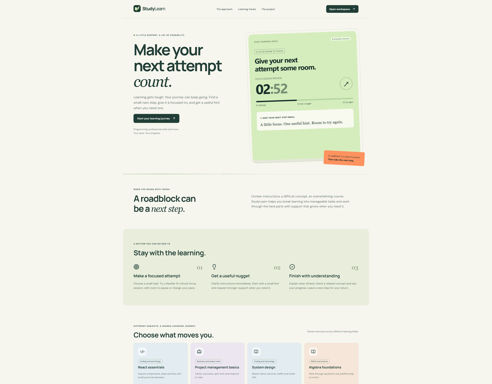
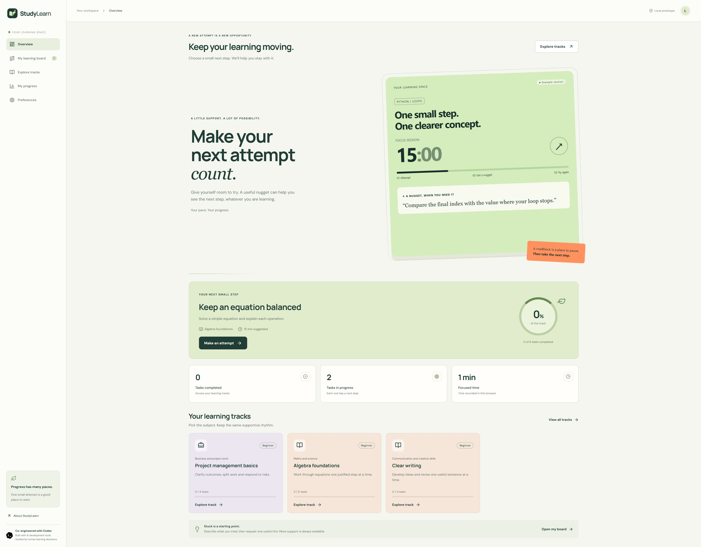
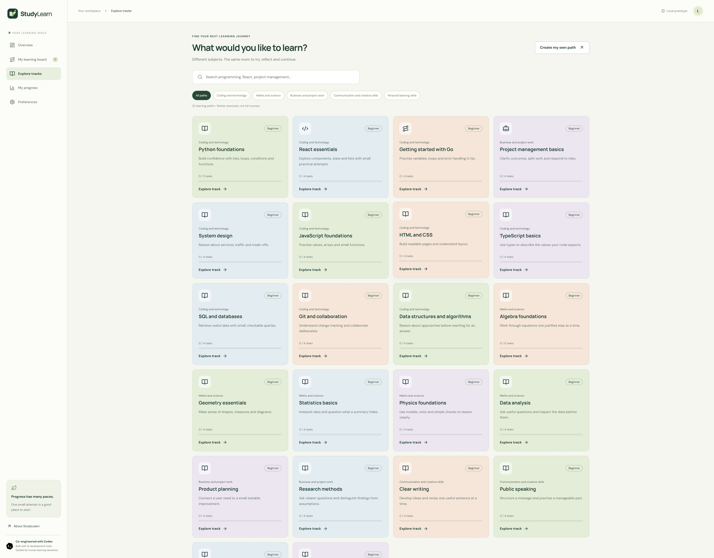
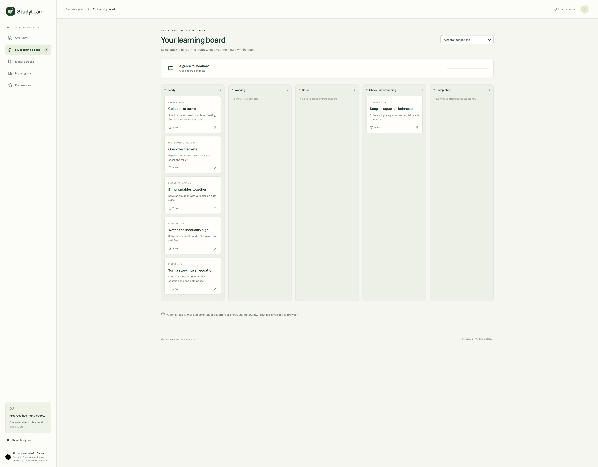
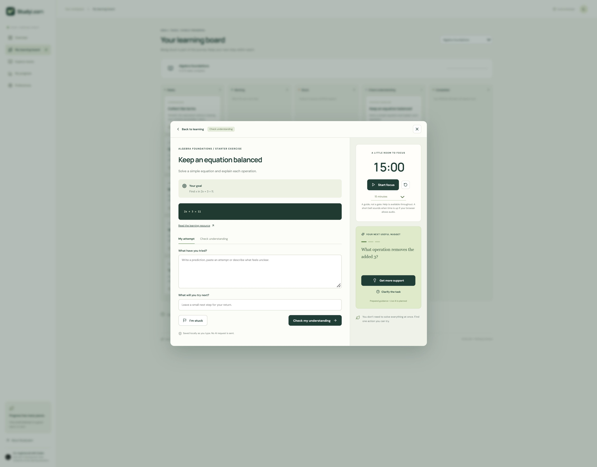
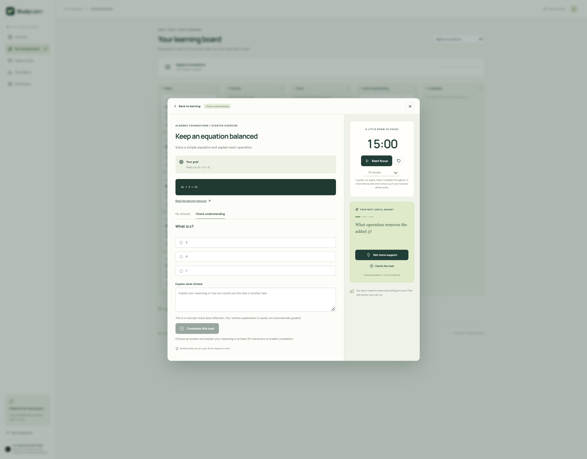

# StudyLearn

**Make your next attempt count.**

StudyLearn is a learning companion that helps people work through roadblocks, ask for useful guidance and return to unfinished learning. It supports programming, mathematics, project work, communication and other learning goals.

**Status:** working invention-sprint proof of concept, with 91 starter exercises across 22 learning paths. Guidance is prepared locally. Live AI assistance is planned.

## Problem statement

Finding a course is only the beginning. When instructions are unclear or a concept becomes difficult, a learner may stop, postpone the lesson or ask AI for a complete answer before making a meaningful attempt. Finishing this way can leave the underlying concept unclear.

The idea grew from the creator's experience of abandoning Coursera learning when roadblocks interrupted progress and feeling tempted to turn immediately to AI.

For the students across Africa described in the challenge brief, these difficulties can intersect with unreliable connectivity, limited mobile data, basic devices, inaccessible interfaces and scattered materials. StudyLearn responds to the moment a learner gets stuck. Its educational impact still needs learner validation.

## The solution

StudyLearn gives learners a small, visible next step and room to attempt it. When support is needed, a nugget begins with a prompt and grows into more explicit guidance. Learners finish by answering a concept question and explaining what clicked.

The aim is to build confidence in reasoning and make returning to learning easier. A focus session is **a guide, not a gate**: clarification and support remain available at any time.

The board takes inspiration from task-management tools such as Jira. It organises learning into manageable tasks and visible states without requiring a Jira account or integration.

### Challenge track

The primary fit is **Track 2: Engagement & Staying in the Learning Journey**. Manageable attempts, guidance and visible progress address disengagement at a roadblock.

Source-linked tasks also support Track 1, Access & Discovery of Learning Resources. Connections to credentials, careers and opportunities under Track 3 are a future direction.

### Intended learners

- Beginner programmers practising new concepts.
- University students working through mathematics, technical subjects and other coursework.
- Learners taking professional or personal courses who need a way to continue after getting stuck.

## The learning journey

1. Choose a starter path or create a personal path.
2. Open a small task and read its goal, example and source.
3. Record a prediction, an attempt or what feels unclear.
4. Choose focused time, starting with the default 15 minutes.
5. Request clarification or progress through three prepared nuggets.
6. Answer a concept question and explain your reasoning.
7. Save a next step and return to the learning board.

For example, an algebra task asks the learner to solve `2x + 3 = 11`. The first nugget asks which operation removes the added three. The learner works towards `x = 4` and explains why both sides must remain balanced.

## Implemented features

| Feature | Current behaviour |
| --- | --- |
| Learning catalog | 22 searchable paths across five fields, with 91 starter exercises |
| Personal paths | Goals for other subjects and an optional resource link |
| Task workspace | Goal, example, source, attempt notes and a saved next step |
| Progressive nuggets | Three prepared levels per built-in task, plus clarification |
| Flexible focus | 1, 5, 10, 15, 20 and 25-minute choices; default 15 |
| Timer safeguards | Duration locks after starting, including while paused; reset unlocks it |
| Expiry feedback | Visible time-up feedback and a short bell when browser audio is available |
| Completion safeguards | Disabled until an answer and a trimmed explanation of at least 20 characters are present |
| Concept checks | Wrong answers do not complete a task; written explanations are saved but not automatically graded |
| Learning board | Ready, Working, Stuck, Check understanding and Completed |
| Local progress | Saved attempts, focused time, JSON export and explicit reset confirmation |
| Automatic preview | Python nugget, accelerated countdown, animated Go output and StudyLearn artwork |
| Responsive design | Phone layouts, keyboard focus styling and reduced-motion support |
| Branding | Joined StudyLearn wordmark, sharing artwork and Codex development credit |

The homepage countdown is an illustration. It runs faster than real time, has no controls and records no learner focus time. Actual task timers count real elapsed time.

## Learning coverage

These are starter exercises, not complete accredited courses.

| Field | Learning paths | Exercises |
| --- | --- | ---: |
| Coding and technology | Python, React, Go, system design, JavaScript, HTML and CSS, TypeScript, SQL, Git, data structures and algorithms | 41 |
| Maths and science | Algebra, geometry, statistics, physics, data analysis | 22 |
| Business and project work | Project management, product planning, research methods | 12 |
| Communication and creative skills | Clear writing, public speaking, accessible interface design | 12 |
| Personal learning skills | Learning and study skills | 4 |
| **Total** | **22 paths** | **91** |

Algebra has six exercises: balancing an equation, collecting like terms, expanding brackets, variables on both sides, inequalities and a word problem. Python has five; every other built-in path has four. Personal paths allow learners to bring other subjects into the same flow.

## Screenshots

These screenshots show the working prototype with local demonstration progress. The images are included in `docs/screenshots/` so they travel with the repository.

### Homepage

The marketing page introduces StudyLearn and its automatic learning preview.



### Application home

The learner's home combines the preview with a next task and progress.



### Learning paths

Browse subjects, search the catalog and filter by field.



### Learning board

The algebra board contains six tasks and makes their learning states visible.



### Exercise and nugget

The workspace brings the goal, source, attempt notes, timer and progressive guidance together.



### Understanding check

Completion stays disabled until the required answer and explanation are provided.



## Technology and architecture

- React 19 for the interface.
- TypeScript for task models, learning state and validation.
- Vite for development and production bundling.
- Lucide React for icons.
- CSS for responsive layouts and motion.
- Browser localStorage for attempts, personal paths and progress.
- Service worker for caching after a successful online visit.

The current application runs in the browser. It has no account service, cloud database, live AI endpoint or code-execution sandbox.

### Project structure

```text
src/
  App.tsx           Pages, catalog, board and task workspace
  HeroPreview.tsx   Automatic learning illustration
  FocusMoment.tsx   Focus component retained in the source
  data.ts           Types, starter catalog and personal paths
  modules.ts        Expanded exercises
  logic.ts          Completion, recovery, hints and timers
  styles.css        Responsive layouts and motion
public/assets/      Logos and sharing artwork
docs/screenshots/   README gallery
scripts/test.mjs    Regression checks
TEST-REPORT.txt     Verification history and limitations
vite.config.js      Build and service-worker configuration
```

## Run locally

Install Node.js **22.12 or newer**, then run:

```powershell
Set-Location 'C:\Users\durojaiye moturayo\studylearn'
npm install
npm run dev
```

Open the HTTP address printed by Vite. The port may change if another application is using the default port.

### Test and build

```powershell
npm test
npm run build
npm run preview
```

The build validates TypeScript and creates the production bundle in `dist/`. Preview serves that bundle locally. Open the site through its HTTP address rather than double-clicking built HTML.

## Verification

Strict TypeScript validation and **23 regression checks** passed in the development environment. Checks cover progress recovery, completion requirements, wrong answers, hint boundaries, wall-clock timers, unique tasks, learning coverage and personal paths.

Browser checks covered task guidance, completion safeguards, navigation, the automatic preview and a 390px phone layout. See [TEST-REPORT.txt](TEST-REPORT.txt).

The environment blocked shell subprocesses, so the standard npm/Vite production build still needs to run on the development machine. Broader device testing, actual phone audio behaviour, accessibility checks with learners and evidence of improved completion remain outstanding.

## Operating conditions and limitations

| Area | Current approach and remaining work |
| --- | --- |
| Quality and credibility | Built-in tasks link to resources including official documentation, OpenStax and W3C. Exercises still need subject-matter review; links alone do not guarantee correctness. Personal resources depend on what learners supply. |
| Low bandwidth | Application files are cached after a successful visit. First access, external sources and uncached resources need connectivity. System font fallbacks are available. |
| Accessibility | Labelled controls, focus styles, phone layouts and reduced-motion support are implemented. Full conformance and usability across literacy levels are not established. |
| Personalisation | Learners choose subject, task, duration and support level. Personal paths support other subjects. Automated profiling is not implemented. |
| Privacy | Progress stays in the browser and no AI request is sent. Shared devices can expose local notes; clearing browser storage can remove progress. JSON export provides a separate copy. |
| Multilingual access | Current interface and prepared content are English. French, Portuguese, Arabic and local-language access are planned. |
| Local relevance | Starter paths are not yet mapped to local curricula, institutions, accredited credentials or opportunities. |

Offline access depends on a successful first visit and cached files. There is no cross-device sync or account-based protection.

## How Codex was used

The project direction came from the creator's learning experience and decisions about the intended learners. Codex supported implementation of React and TypeScript components, task structure, timer and completion safeguards, responsive layouts, checks and documentation.

Human review guided the scope, brand, learning approach and interface changes. AI-assisted development does not establish educational effectiveness or replace content review.

The site includes a **Co-engineered with Codex** credit. Codex helped build the prototype. Live AI tutoring is a separate planned capability.

## Next milestones

1. Complete the production build and broaden device, offline and accessibility checks.
2. Have educators review exercises, answers and guidance.
3. Test roadblock recovery with learners and refine the flow.
4. Prototype live AI nuggets with source grounding and answer-quality checks.
5. Explore multilingual content, curriculum relevance and optional cross-device progress.
6. Connect demonstrated skills to appropriate next steps and opportunities.

Possible evaluation measures include resuming after a roadblock, completing a concept check with reasoning, returning for another session and reporting a clearer next step. These are proposed measures, not proven results.

## Sharing and deployment

Logo and sharing artwork are in `public/assets/`. Set `VITE_SITE_URL` to the public origin before building so sharing tags use absolute URLs. See [.env.example](.env.example).

Publish the built `dist/` directory to a static host and verify the deployed site, sharing image and offline behaviour. This README does not claim a public deployment.
